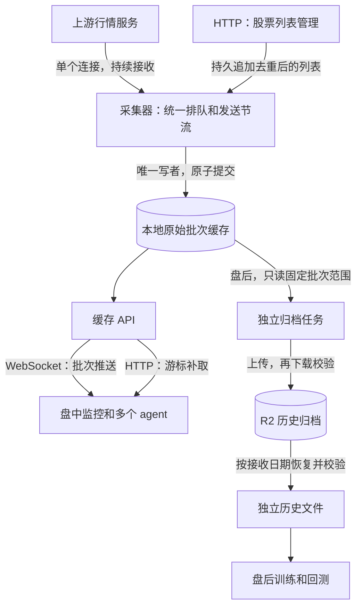

# L2 服务架构

## 1. 目的

本服务为个人量化平台采集并保存 L2 原始市场批次。盘中消费者用于监控。盘后消费者用于数据检查、训练和回测。

本文采用短句、固定术语和分步说明。中文表述参考 ASD-STE100 的写作原则。“80%”是写作目标，不是该标准的认证分数。

## 2. 结构

HTTP 和 WebSocket 共用磁盘缓存。各消费者保存自己的游标。多个消费者不会新增上游连接或行情查询。当前 WebSocket 按连接读取缓存，尚未使用内存广播。

## 3. 上游请求

已验证的请求格式每次指定一只股票和一路数据。每只股票需要成交、买委托、卖委托三次启动查询。

| 股票数 | 业务启动查询 | 初始会话发送 | 后续接收方式 |
| --- | ---: | ---: | --- |
| 20 | 60 | 1 | 同一连接被动接收 |

60 次是启动成本，不是每秒发送量。所有业务请求进入同一个队列。下一次发送开始距上次发送完成至少一秒。等待发送期间，采集器继续接收已注册流。

目前没有证据证明上游支持一次查询多个股票。不能把现有请求格式的单股限制称为数据源的全部协议上限。一秒是本服务的实验节奏，不是上游承诺的额度。

## 4. 盘中读取

监控服务先用 HTTP 提交股票列表，再通过 WebSocket 消费批次。发生断线时，使用最后已处理游标重连或 HTTP 补取。

处理完整页并提交消费结果后，消费者保存 `next_sequence`。处理失败时，从上一次已保存游标重新读取。消息可以重放，消费结果应按本地批次序号处理重试。

HTTP、WebSocket 的地址、字段和调用示例见 [接口说明](l2-interface.md)。服务只监听服务器回环地址。跨主机使用既有 SSH 访问边界。

## 5. 盘后读取

归档任务读取完整提交的市场批次。任务开始时固定本轮末批序号。之后新到的批次留给下一轮。

归档按上海时区的接收日期分组。日期不表示已经认证的交易所业务日。历史文件保留原始批次、原始序号、接收时间、股票绑定、epoch 和原始字段。

上传完成后，任务检查大小和 SHA256，再重新下载并验证内容。全部文件验证完成后，任务发布日期索引。恢复程序依据索引下载，并再次校验，成功后才发布目标目录。操作说明见 [归档和恢复](l2-archive.md)。

训练和回测批量读取恢复文件。不要从实时接口反复扫描全部历史。字段单位、成交粒度和事件身份尚未认证时，下游应保留原始值，并单独验证研究所需的转换。

## 6. 设计判断

当前结构满足小型量化平台的两条主要数据路径。采集器负责上游协议。API 负责缓存消费。归档任务负责远端保存和恢复。归档不持有上游会话，也不参与盘中发送。

本次复用已有缓存和 R2 客户端。不新增消息代理、数据库、分布式限流或通用存储框架。各部分通过已提交批次和版本化清单交接。

这是一项有条件的设计判断，不能称为绝对最优。当前缓存检查成本会随历史批次数增长。每个 WS 消费者也会读取磁盘。先测20股、60路及双 HTTP、双 WS 的实际延迟和资源占用；只有测量显示不满足要求时，才调整直接相关的读取路径。

## 7. 当前边界

- 100 是代码保护上限，不是数据源容量上限。
- 种子、心跳和注册成功不证明持续更新。每只股票的三路都要单独验收。
- 归档只能保存已经接收到的数据。它不能恢复未采集的数据或自动补齐源端缺口。
- 原始序号是本地批次序号，不是交易所事件编号。
- 首版保留全部本地缓存，不配置本地删除或 R2 生命周期。
- 周一先验收20股并完成核心常驻部署，再激活独立归档任务，随后开展扩容。

## 8. 参考资料

- [ASD-STE100 官方说明](https://www.asd-ste100.org/about_STE.html)：受控英语的写作原则。
- [R2 一致性说明](https://developers.cloudflare.com/r2/reference/consistency/)：S3 直接读写和条件写入的行为。
- [R2 对象生命周期](https://developers.cloudflare.com/r2/buckets/object-lifecycles/)：远端保留期仍受 bucket 规则约束。
